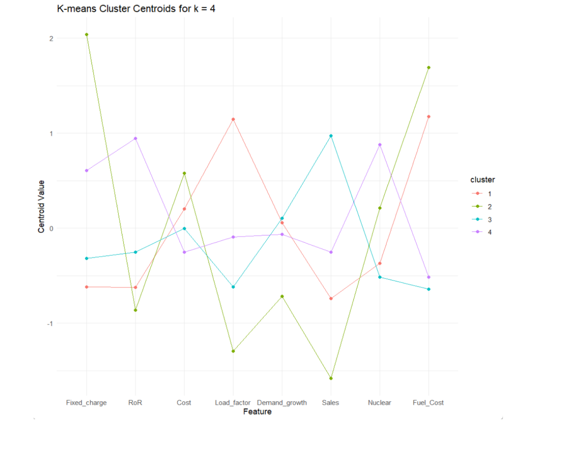
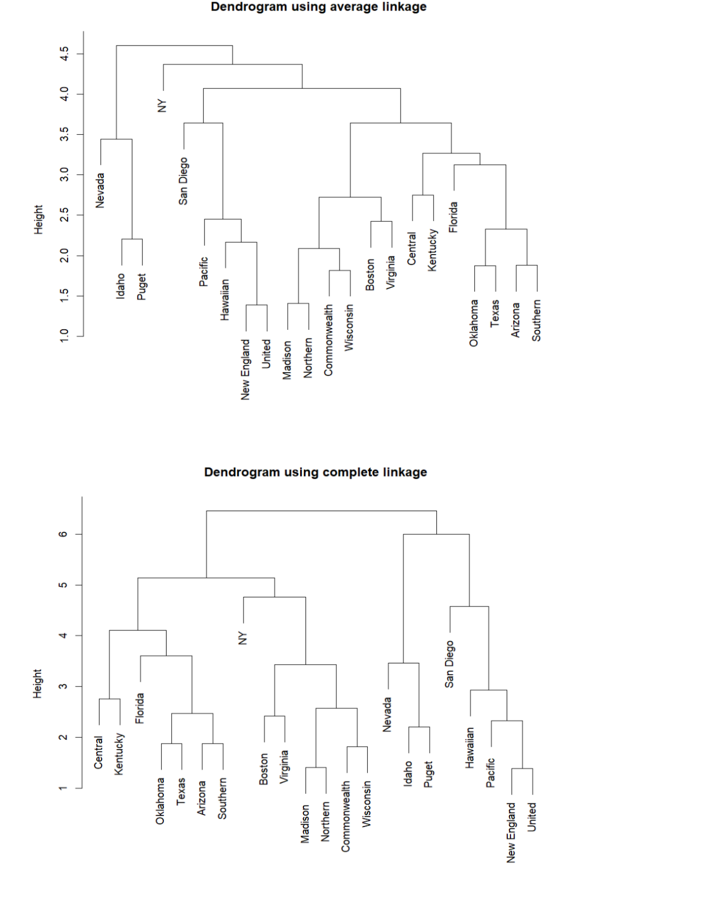
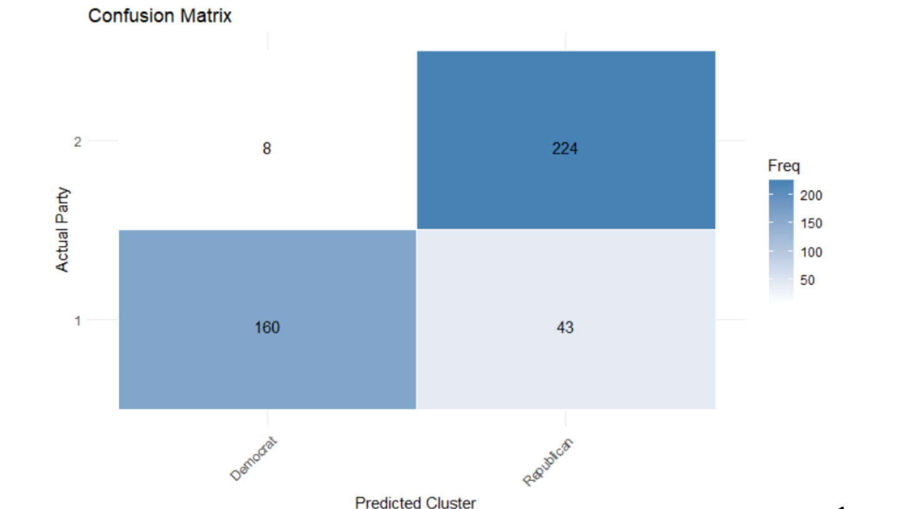

# Clustering Analysis: Utility Companies and 1984 Congress Votes

[](https://www.r-project.org/)
[](LICENSE)

Clustering analysis in R — k-means and hierarchical clustering applied to two datasets: financial and operating attributes of US utility companies, and the 1984 US House roll-call votes.

## Key Results

- **1984 Congress votes:** k-means (k = 2) on the voting records of 435 House members recovers party affiliation with **88.28% accuracy** — 160 of 168 Democrats and 224 of 267 Republicans correctly identified. Recall is 95.24% for Democrats, specificity 83.90% for Republicans, precision 78.82%, F1 score 86.25%.
- **Utility companies:** k-means with **k = 4 beats k = 13** — the four clusters separate cleanly across almost all eight attributes, while k = 13 over-splits them.
- **Hierarchical clustering:** **average linkage** is the most reasonable choice — it minimizes within-cluster variance and is less sensitive to noise and outliers than complete linkage. Cutting the tree at k = 4 gives interpretable, actionable groups.

## What this covers

### Part 1 — Utility companies

The `Utilities` dataset describes 22 utility companies across 8 attributes: fixed charge, rate of return, cost, load factor, demand growth, sales, nuclear share, and fuel cost. After standardizing the features:

- **K-means** with k = 4 and k = 13 — **k = 4 gives the better clustering**, with clear separation across almost all attributes, while k = 13 groups some attributes together in a single cluster.



*K-means cluster centroids for k = 4 across the eight standardized utility attributes — the four clusters separate clearly.*

- **Hierarchical clustering** with single, average, and complete linkage — **average linkage is the most reasonable choice**: it minimizes within-cluster variance and is less sensitive to noise and outliers than complete linkage, which is stricter and forces more compact clusters. The tree is cut at k = 4 (interpretable, actionable groups) rather than k = 13 (overly granular).



*Hierarchical clustering dendrograms for the 22 utility companies: average linkage (top) and complete linkage (bottom).*

### Part 2 — 1984 Congress votes

K-means with k = 2 on the voting records of 435 House members across 16 roll-call votes (1 = yea, −1 = nay, 0 = abstain), checked against the members' true party affiliations (267 Republican, 168 Democrat):

| Metric | Value |
| --- | --- |
| Accuracy | 88.28% |
| Precision | 78.82% |
| Recall (sensitivity) | 95.24% |
| Specificity | 83.90% |
| F1 score | 86.25% |

Confusion matrix (Democrat as the positive class): 160 Democrats correctly identified, 224 Republicans correctly identified, 43 Republicans misclassified as Democrats, 8 Democrats misclassified as Republicans. Voting behavior alone recovers party affiliation well — Democrats are identified almost perfectly (95.24% recall), while a minority of Republicans vote with the Democratic cluster.



*Confusion matrix of the k = 2 clustering against true party affiliation: 160 Democrats and 224 Republicans correctly identified.*

## Datasets

| File | Contents |
| --- | --- |
| `data/Utilities.csv` | 22 utility companies × 8 attributes |
| `data/congress_1984_votes.csv` | 435 House members × 16 roll-call votes (−1 / 0 / 1) |
| `data/congress_1984_party_affiliations.csv` | True party label (Democrat / Republican) for each of the 435 members |

## How to Run

```r
# From the repository root
source("code/congress_voting_analysis.R")
```

Requires R with the `ggplot2`, `cluster`, and `reshape2` packages. The script covers the utility-company clustering (k-means, hierarchical clustering, centroid plots, heatmaps). The Congress-votes analysis and its results are documented in the report.

## File Layout

```
congress-voting-analysis/
├── README.md
├── LICENSE
├── code/
│   └── congress_voting_analysis.R   # Utilities clustering (k-means, hierarchical, heatmaps)
├── data/
│   ├── Utilities.csv
│   ├── congress_1984_votes.csv
│   └── congress_1984_party_affiliations.csv
├── images/
│   ├── kmeans-centroids-k4.png
│   ├── dendrograms.png
│   └── confusion-matrix.png
└── report/
    ├── Congress_Voting_Report.pdf
    └── Congress_Voting_Report.docx
```

## License

This project is licensed under the MIT License — see [LICENSE](LICENSE).
